# PizzaApp - Semana 6

## Avanzando hacia Android Studio

---

## 1. Información académica

| Campo | Información |
|---|---|
| Institución | Duoc UC |
| Asignatura | Desarrollo APP Móviles I |
| Código | PMY2201 |
| Experiencia de aprendizaje | 2 |
| Semana | 6 |
| Actividad | Avanzando hacia Android Studio |
| Tipo de evaluación | Sumativa individual |
| Estudiante | Pedro Breit |
| Proyecto | PizzaApp |

## 2. Descripción del proyecto

PizzaApp es una aplicación móvil desarrollada en Kotlin
y Jetpack Compose, orientada a la gestión de clientes,
productos, pedidos, inventario y despacho de una pizzería.

El proyecto corresponde a una evolución de la solución
implementada durante las semanas anteriores, conservando
las reglas de negocio, las validaciones de datos,
los cálculos comerciales y la arquitectura modular.

Durante la semana 6 se incorporaron animaciones Fade In
y Fade Out, un menú desplegable con íconos e indicadores
de progreso, con el propósito de mejorar la interacción
y la experiencia de usuario.

## 3. Objetivos

### 3.1. Objetivo general

Optimizar la aplicación PizzaApp mediante la integración
de componentes gráficos e interactivos de Android,
utilizando Kotlin, Jetpack Compose y Android Studio.

### 3.2. Objetivos específicos

- Implementar animaciones Fade In y Fade Out.
- Incorporar un menú desplegable con íconos representativos.
- Implementar indicadores de progreso.
- Administrar estados mediante ViewModel y LiveData.
- Integrar las funcionalidades con las reglas de negocio.
- Mantener la organización modular mediante Gradle.
- Realizar pruebas en diferentes dispositivos virtuales.
- Documentar los resultados y evidencias de funcionamiento.

## 4. Resultado de aprendizaje

**RA2:** Crea aplicaciones móviles básicas utilizando
herramientas como Android Studio para responder a
requerimientos predefinidos, de acuerdo con estándares
de calidad de la industria.

### 4.1. Indicadores de logro

**IL4:** Configura el entorno de desarrollo Android Studio
para generar aplicaciones móviles y realizar pruebas
de forma local o remota.

**IL5:** Elabora proyectos en Android y Kotlin utilizando
Gradle, asegurando la correcta organización del código
y la modularización de componentes.

**IL6:** Implementa animaciones en Android (Fade In/Out),
menús y notificaciones de progreso utilizando Kotlin,
añadiendo dinamismo y mejorando la experiencia de usuario
en la aplicación.

## 5. Tecnologías utilizadas

| Tecnología | Aplicación |
|---|---|
| Kotlin 2.2.10 | Lenguaje de programación |
| Android Studio | Entorno integrado de desarrollo |
| Jetpack Compose | Desarrollo de interfaces declarativas |
| Material Design 3 | Componentes gráficos |
| Gradle | Compilación y gestión de dependencias |
| ViewModel | Administración de estados de interfaz |
| LiveData | Observación de datos |
| Kotlin Coroutines | Gestión de operaciones asíncronas |
| Android Virtual Device | Pruebas en dispositivos virtuales |
| Git | Control de versiones |
| GitHub | Repositorio de código fuente |

## 6. Evolución del proyecto

| Semana | Contenidos aplicados |
|---|---|
| 1 | Fundamentos del lenguaje Kotlin |
| 2 | Programación orientada a objetos y lógica de negocio |
| 3 | Validaciones y estructuras avanzadas de Kotlin |
| 4 | Configuración de Android Studio y AVD |
| 5 | Integración de Kotlin, Gradle y modularización |
| 6 | Animaciones, menús e indicadores de progreso |

Para el desarrollo de la semana 6 se creó una copia
independiente del proyecto de la semana 5, permitiendo
conservar las versiones anteriores y mantener un registro
de la evolución de la aplicación.

## 7. Arquitectura y estructura del proyecto

La aplicación mantiene una arquitectura modular compuesta
por tres módulos principales.

| Módulo | Responsabilidad |
|---|---|
| app | Interfaz gráfica, navegación y estados |
| data | Modelos de dominio, repositorio y lógica de negocio |
| utils | Funciones reutilizables y validaciones |

### 7.1. Estructura de directorios

```text
semana-6/
├── README.md
├── evidencias/
└── pizzeria-app/
    ├── app/
    │   ├── src/main/
    │   │   ├── java/com/example/pizzeriaapp/
    │   │   │   ├── ui/theme/
    │   │   │   ├── IndicadorCarga.kt
    │   │   │   ├── InventarioScreen.kt
    │   │   │   ├── MainActivity.kt
    │   │   │   ├── MenuPrincipal.kt
    │   │   │   ├── NavegacionAnimada.kt
    │   │   │   ├── PizzeriaViewModel.kt
    │   │   │   ├── ProductosScreen.kt
    │   │   │   └── ResumenScreen.kt
    │   │   ├── res/
    │   │   └── AndroidManifest.xml
    │   └── build.gradle.kts
    ├── data/
    ├── utils/
    ├── gradle/
    ├── build.gradle.kts
    ├── settings.gradle.kts
    └── gradle.properties
```

### 7.2. Responsabilidad de los componentes

| Archivo | Responsabilidad |
|---|---|
| MainActivity.kt | Integración y navegación de la aplicación |
| NavegacionAnimada.kt | Control de transiciones entre pantallas |
| MenuPrincipal.kt | Menú desplegable e íconos |
| IndicadorCarga.kt | Componente reutilizable de progreso |
| PizzeriaViewModel.kt | Administración de datos y estados |
| ProductosScreen.kt | Catálogo independiente de productos |
| ResumenScreen.kt | Indicadores y resumen de operaciones |
| InventarioScreen.kt | Consulta y reposición de ingredientes |

### 7.3. Evidencia de modularización

La siguiente imagen presenta la estructura del proyecto
y los módulos reconocidos por Android Studio.

<p align="center">
  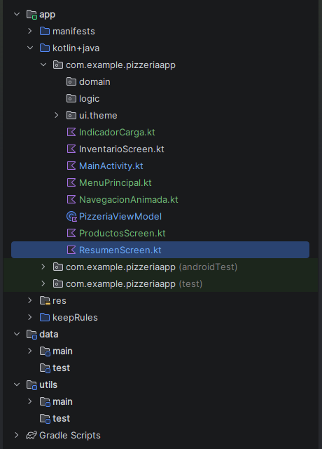
</p>

## 8. Implementación de funcionalidades

### 8.1. Pantalla principal

La pantalla principal proporciona acceso a las funciones
del sistema y presenta un resumen dinámico de operaciones.

Incluye:

- Barra superior con menú desplegable.
- Cantidad de clientes registrados.
- Cantidad de pedidos realizados.
- Último cliente registrado.
- Actualización manual del resumen.
- Acceso al registro de pedidos.
- Acceso a la gestión de inventario.

<p align="center">
  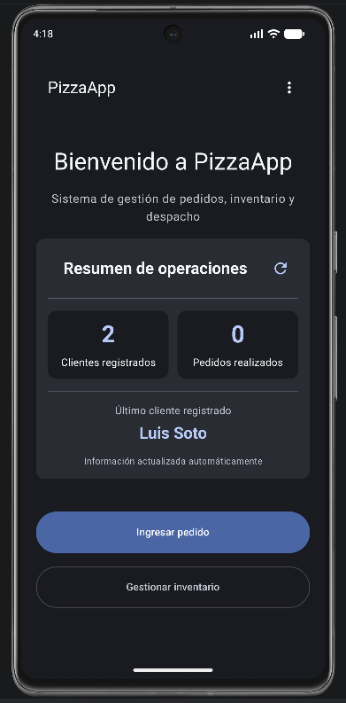
</p>

### 8.2. Animaciones Fade In y Fade Out

Las animaciones se implementaron mediante el componente
AnimatedVisibility de Jetpack Compose.

Se utilizaron las siguientes herramientas:

- AnimatedVisibility.
- MutableTransitionState.
- fadeIn().
- fadeOut().
- tween().
- LaunchedEffect.
- snapshotFlow.

Cada animación tiene una duración de 300 milisegundos.

La navegación espera la finalización del Fade Out antes
de reemplazar el contenido de la pantalla, ejecutando
posteriormente el Fade In del nuevo destino.

También se incorporó un mecanismo de bloqueo temporal
de interacciones táctiles durante las transiciones.

#### Evidencia del código

<p align="center">
  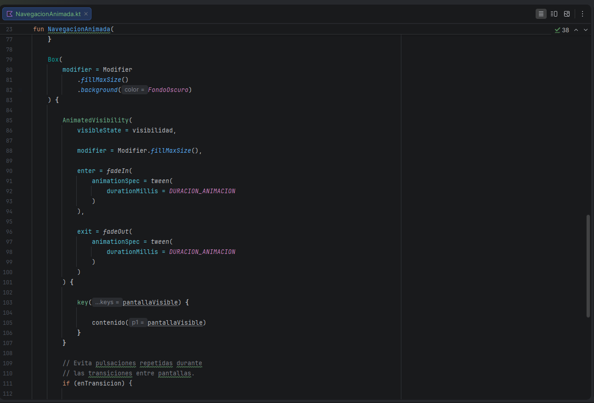
</p>

#### Evidencia audiovisual

[Ver video de animaciones Fade In y Fade Out](evidencias/04_05_Animaciones_FadeIn_FadeOut.mp4)

### 8.3. Menú desplegable

Se implementó un menú mediante DropdownMenu,
DropdownMenuItem, TopAppBar e IconButton.

El menú permite acceder a las siguientes funcionalidades:

| Opción | Funcionalidad |
|---|---|
| Inicio | Regreso a la pantalla principal |
| Gestión de clientes | Consulta y registro de clientes |
| Productos | Visualización del catálogo |
| Registrar pedido | Inicio del proceso de venta |
| Gestionar inventario | Consulta y reposición |
| Resumen de operaciones | Consulta de indicadores |

Cada opción incorpora un ícono representativo y se
encuentra integrada con la navegación animada.

<p align="center">
  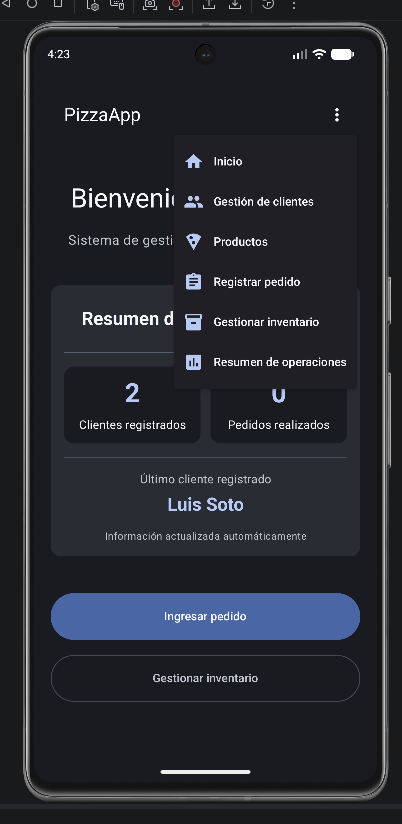
</p>

### 8.4. Indicadores de progreso

Se implementó un componente reutilizable basado en
CircularProgressIndicator, integrado con el ViewModel
y los estados observables de LiveData.

Los estados utilizados son:

| Estado | Responsabilidad |
|---|---|
| cargando | Controlar la visibilidad del indicador |
| mensajeCarga | Informar la operación en ejecución |
| errorCarga | Comunicar errores durante la consulta |

El indicador se activa durante:

- La carga inicial de la aplicación.
- La consulta de clientes.
- El registro de clientes.
- La actualización de pedidos.
- La generación del resumen de operaciones.

Se incorporó una demora demostrativa de 1.200
milisegundos para visualizar el estado de carga,
considerando que el repositorio trabaja en memoria.

Se utilizan corrutinas para administrar las consultas,
controlar su cancelación y evitar inconsistencias
entre solicitudes simultáneas.

[Ver video de indicadores de progreso](evidencias/12_Indicador_Progreso.mp4)

### 8.5. Gestión de clientes

La aplicación permite consultar y registrar clientes
sin necesidad de iniciar un pedido.

Se mantienen las validaciones desarrolladas durante
las semanas anteriores:

- Nombre obligatorio.
- Validación y formato de teléfono.
- Validación de correo mediante expresiones regulares.
- Control de registros duplicados.

#### Consulta y registro

<p align="center">
  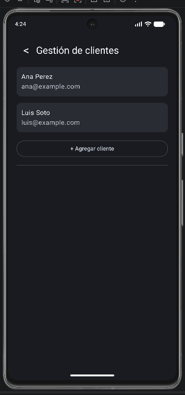
  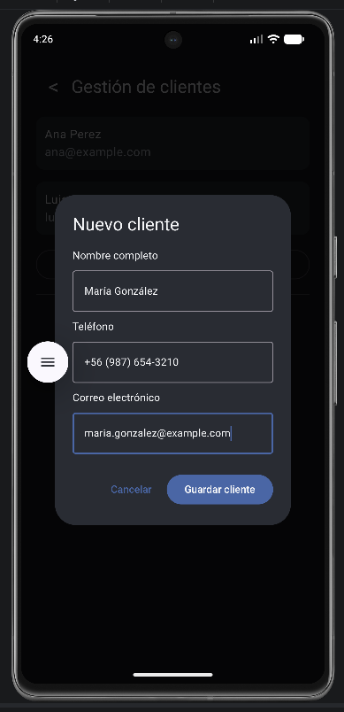
</p>

#### Validación de datos

<p align="center">
  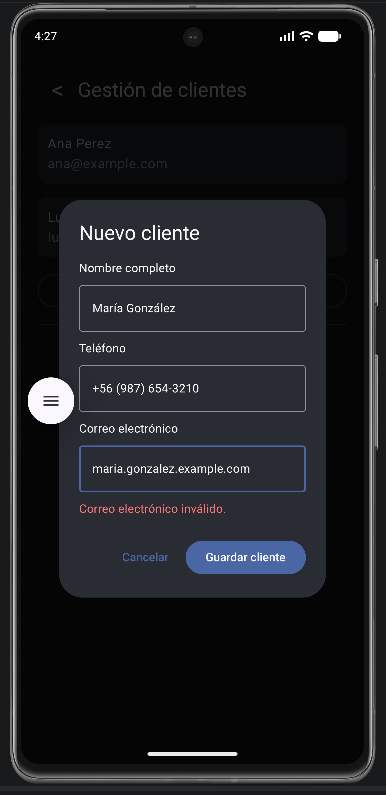
  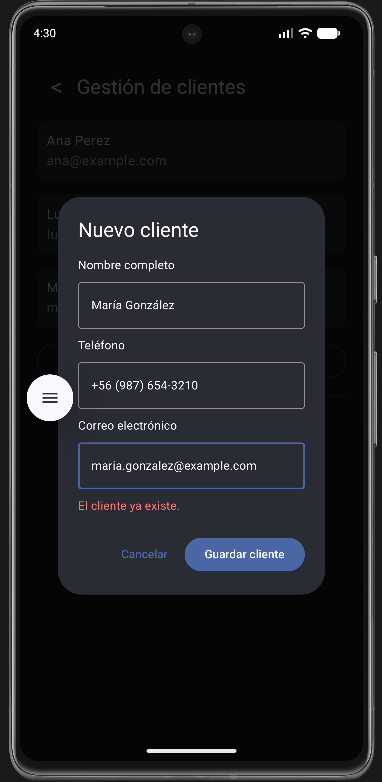
</p>

### 8.6. Catálogo de productos

Se incorporó una pantalla independiente para consultar
los productos disponibles.

| Producto | Precio |
|---|---:|
| Margarita | $8.000 |
| Pepperoni | $10.000 |
| Vegetariana | $9.000 |

Cada producto presenta su nombre, precio, ingredientes
e ícono representativo.

<p align="center">
  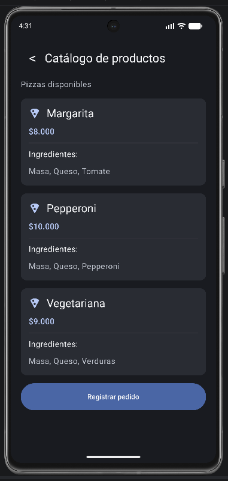
</p>

### 8.7. Resumen dinámico de operaciones

El resumen se actualiza mediante ViewModel y LiveData,
permitiendo visualizar los cambios realizados en el
repositorio de datos.

La siguiente evidencia demuestra el incremento de
dos a tres clientes registrados después de incorporar
a María González.

<p align="center">
  
  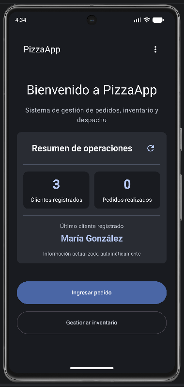
</p>

### 8.8. Registro de pedidos

Se conservaron las funcionalidades originales de
selección de productos, selección de clientes,
descuentos, impuestos y cálculo del total.

Durante las pruebas se registró el siguiente pedido:

| Concepto | Valor |
|---|---:|
| Margarita x 2 | $16.000 |
| Vegetariana x 1 | $9.000 |
| Subtotal | $25.000 |
| Descuento | $1.250 |
| IVA 19 % | $4.513 |
| Total final | $28.263 |

<p align="center">
  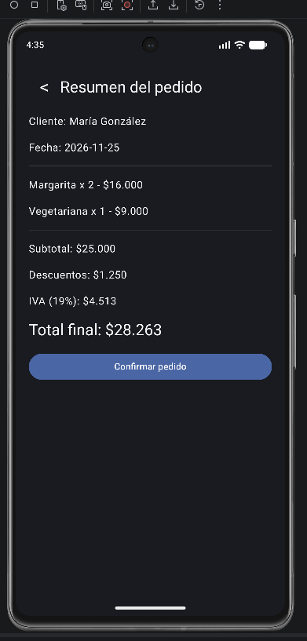
</p>

La confirmación del pedido activa un indicador de
progreso mientras se actualizan los datos del sistema.

[Ver video de progreso durante la confirmación del pedido](evidencias/15_Progreso_Pedido.mp4)

### 8.9. Preparación y despacho

La aplicación conserva la administración de estados
del pedido:

1. En preparación.
2. Listo.
3. En camino.
4. Entregado.

La asignación de repartidores considera la disponibilidad
y la distancia registrada.

En la prueba realizada se asignó al repartidor Diego,
ubicado a 1,2 kilómetros, quien volvió a estar disponible
al finalizar la entrega.

<p align="center">
  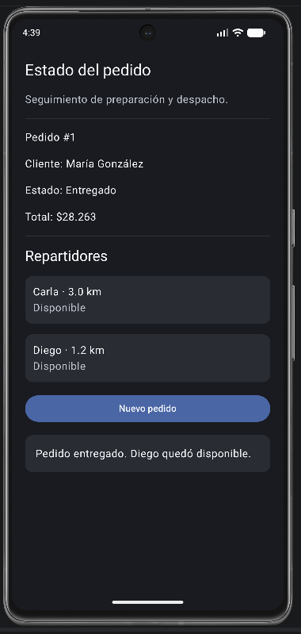
</p>

### 8.10. Gestión de inventario

La aplicación permite consultar las existencias de
ingredientes y realizar reposiciones.

Durante la prueba se incorporaron cinco unidades
de Pepperoni, obteniendo una actualización de stock
y un mensaje de confirmación.

<p align="center">
  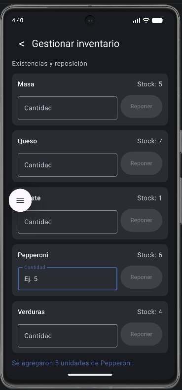
</p>

## 9. Integración de funcionalidades

Las funcionalidades implementadas durante la semana 6
se encuentran integradas con la lógica de negocio
desarrollada en las semanas anteriores.

El flujo general de la aplicación es:

```text
Interfaz Jetpack Compose
          |
          v
Menú y navegación animada
          |
          v
PizzeriaViewModel
          |
          v
Repositorio y lógica de negocio
          |
          v
Actualización mediante LiveData
          |
          v
Indicadores de progreso y resultados
```

La integración considera:

- Navegación animada entre pantallas.
- Actualización de datos observables.
- Gestión de estados de carga.
- Manejo de errores de consulta.
- Control de solicitudes simultáneas.
- Protección ante pulsaciones repetidas.
- Control del botón Atrás de Android mediante BackHandler.
- Conservación de los datos durante la navegación normal.
- Protección del pedido activo durante el despacho.

## 10. Pruebas y validaciones

Se realizaron pruebas funcionales y de integración
para verificar el comportamiento de la aplicación.

### 10.1. Casos de prueba

| ID | Caso de prueba | Resultado esperado | Estado |
|---|---|---|---|
| CP-01 | Registro válido de cliente | Registro y actualización del resumen | Aprobado |
| CP-02 | Correo electrónico inválido | Rechazo del registro y mensaje de error | Aprobado |
| CP-03 | Cliente duplicado | Rechazo del registro duplicado | Aprobado |
| CP-04 | Actualización manual del resumen | Indicador de carga y datos actualizados | Aprobado |
| CP-05 | Acceso al resumen desde el menú | Navegación animada y carga de datos | Aprobado |
| CP-06 | Pulsaciones rápidas | Navegación estable | Aprobado |
| CP-07 | Botón Atrás de Android | Respeto del flujo de navegación | Aprobado |
| CP-08 | Segundo dispositivo virtual | Ejecución y distribución correctas | Aprobado |
| CP-09 | Revisión de Logcat | Ausencia de errores críticos observados | Aprobado |

### 10.2. Resultados

| Indicador | Resultado |
|---|---:|
| Casos ejecutados | 9 |
| Casos aprobados | 9 |
| Casos rechazados | 0 |
| Porcentaje de aprobación | 100 % |

Los resultados corresponden a las pruebas manuales
realizadas durante el desarrollo y validación local.

## 11. Pruebas en dispositivos virtuales

La aplicación se ejecutó en dos dispositivos virtuales
con diferentes configuraciones de pantalla y versiones
de Android.

| Característica | Dispositivo 1 | Dispositivo 2 |
|---|---|---|
| Modelo | Pixel 4 | Pixel 7 Pro |
| API | 36.0 | 37.0 |
| Pantalla nominal | 5,7 pulgadas | 6,7 pulgadas |
| Resolución nominal | 1080 x 2280 | 1440 x 3120 |
| Instalación | Exitosa | Exitosa |
| Ejecución | Correcta | Correcta |
| Pruebas funcionales | Aprobadas | Aprobadas |

### 11.1. Pixel 4 - API 36.0

<p align="center">
  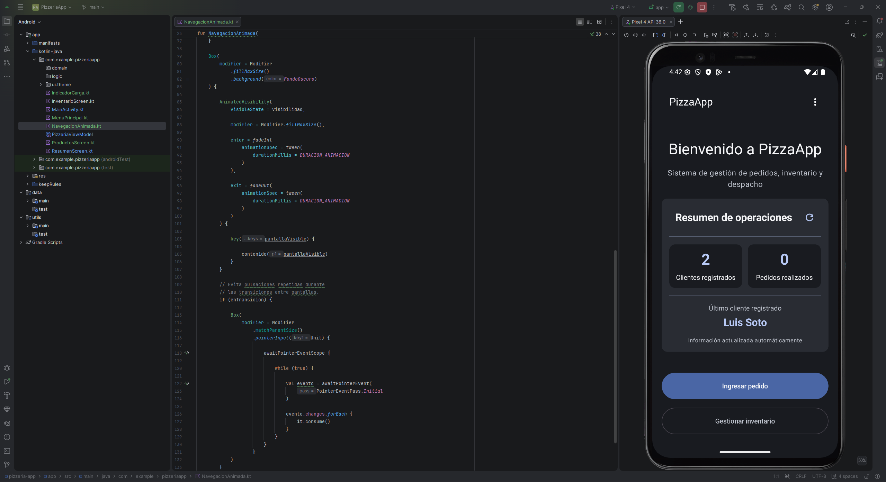
</p>

### 11.2. Pixel 7 Pro - API 37.0

<p align="center">
  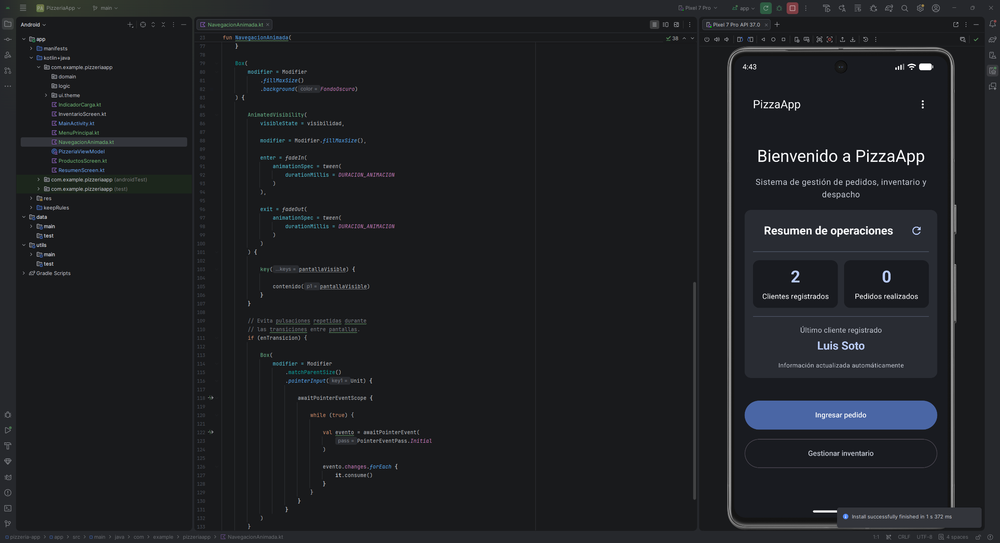
</p>

Las pruebas permitieron comprobar la distribución de
los componentes gráficos, la legibilidad de los textos,
el acceso a las funcionalidades y la estabilidad
de la aplicación en ambos dispositivos.

## 12. Revisión de Logcat

Se utilizó Logcat de Android Studio para revisar
los registros de errores asociados a PizzaApp.

Filtro aplicado:

```text
package:com.example.pizzeriaapp level:ERROR
```

Durante la revisión no se observaron registros de error
que coincidieran con el filtro aplicado.

Este resultado respalda la estabilidad observada durante
las pruebas, sin constituir una garantía de ausencia
de errores en todos los escenarios posibles.

<p align="center">
  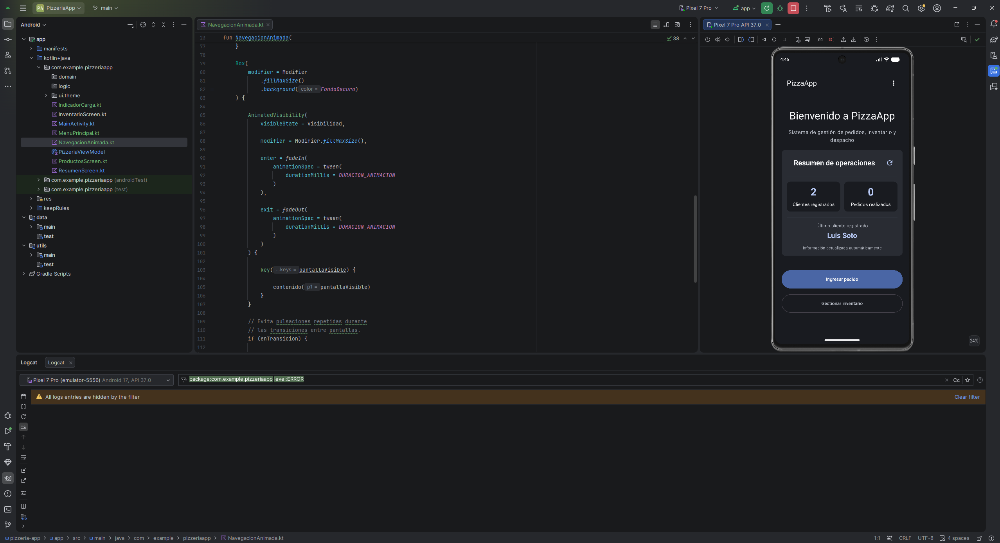
</p>

## 13. Demostración funcional

El siguiente video presenta una demostración integrada
de las principales funcionalidades de PizzaApp.

Incluye la navegación, el registro de clientes,
los indicadores de progreso, la gestión de pedidos,
el despacho y la reposición de inventario.

[Ver demostración funcional completa de PizzaApp](evidencias/21_Demostracion_Funcional.mp4)

## 14. Consolidado de evidencias

| N.° | Evidencia | Archivo |
|---|---|---|
| 01 | Estructura del proyecto | [Ver imagen](evidencias/01_Estructura_Proyecto.png) |
| 02 | Pantalla principal | [Ver imagen](evidencias/02_Pantalla_Principal.png) |
| 03 | Código de animaciones | [Ver imagen](evidencias/03_Codigo_Animaciones.png) |
| 04-05 | Fade In y Fade Out | [Ver video](evidencias/04_05_Animaciones_FadeIn_FadeOut.mp4) |
| 06 | Menú desplegable | [Ver imagen](evidencias/06_Menu_Desplegable.png) |
| 07 | Gestión de clientes | [Ver imagen](evidencias/07_Gestion_Clientes.png) |
| 08 | Registro de cliente | [Ver imagen](evidencias/08_Registro_Cliente.png) |
| 09 | Validación de correo | [Ver imagen](evidencias/09_Validacion_Correo.png) |
| 10 | Cliente duplicado | [Ver imagen](evidencias/10_Cliente_Duplicado.png) |
| 11 | Catálogo de productos | [Ver imagen](evidencias/11_Catalogo_Productos.png) |
| 12 | Indicador de progreso | [Ver video](evidencias/12_Indicador_Progreso.mp4) |
| 13 | Resumen actualizado | [Ver imagen](evidencias/13_Resumen_Actualizado.png) |
| 14 | Registro de pedido | [Ver imagen](evidencias/14_Registro_Pedido.png) |
| 15 | Progreso del pedido | [Ver video](evidencias/15_Progreso_Pedido.mp4) |
| 16 | Pedido entregado | [Ver imagen](evidencias/16_Pedido_Entregado.png) |
| 17 | Gestión de inventario | [Ver imagen](evidencias/17_Gestion_Inventario.png) |
| 18 | Prueba Pixel 4 | [Ver imagen](evidencias/18_Prueba_Pixel4.png) |
| 19 | Prueba Pixel 7 Pro | [Ver imagen](evidencias/19_Prueba_Pixel7Pro.png) |
| 20 | Revisión de Logcat | [Ver imagen](evidencias/20_Logcat_Sin_Errores.png) |
| 21 | Demostración funcional | [Ver video](evidencias/21_Demostracion_Funcional.mp4) |

Las evidencias 04 y 05 se encuentran consolidadas
en un único archivo de video.

## 15. Cumplimiento de los criterios de evaluación

| Criterio | Puntaje máximo | Implementación | Evidencias |
|---|---:|---|---|
| Animaciones Fade In/Out | 20 | AnimatedVisibility y transiciones | 03, 04-05 |
| Menú interactivo | 20 | DropdownMenu e iconos | 06, 07, 11 |
| Indicadores de progreso | 20 | CircularProgressIndicator y LiveData | 12, 15 |
| Integración de funcionalidades | 20 | Navegación y lógica de negocio | 08-17, 21 |
| Pruebas y validaciones | 10 | Pruebas manuales y dispositivos virtuales | 18-20 |
| Presentación y entrega | 10 | Código organizado y documentación | README y evidencias |
| Total | 100 | | |

La tabla presenta la trazabilidad entre los criterios
de evaluación y las funcionalidades implementadas.
La calificación definitiva corresponde al docente.

## 16. Instalación y ejecución

### 16.1. Requisitos

- Android Studio compatible con la configuración Gradle.
- Android SDK requerido por el proyecto.
- Java Development Kit compatible con Gradle.
- Dispositivo Android físico o virtual.
- Conexión a Internet para descargar dependencias.

### 16.2. Clonar el repositorio

```bash
git clone https://github.com/PedroBreit/DUOC-DAMI002.git
```

### 16.3. Abrir el proyecto

Desde Android Studio, seleccionar Open y abrir:

```text
DUOC-DAMI002/semana-6/pizzeria-app/
```

### 16.4. Sincronizar Gradle

Esperar la sincronización de las dependencias
y verificar que los módulos app, data y utils
se encuentren correctamente reconocidos.

### 16.5. Ejecutar la aplicación

1. Seleccionar un dispositivo físico o virtual.
2. Seleccionar la configuración de ejecución app.
3. Presionar Run.
4. Esperar la instalación de PizzaApp.
5. Verificar la pantalla de bienvenida.

## 17. Limitaciones y mejoras futuras

La aplicación utiliza un repositorio de datos en memoria.
Por lo tanto, la información registrada durante una
sesión no se conserva permanentemente al finalizar
el proceso de la aplicación.

Los indicadores de progreso incluyen una demora
demostrativa para visualizar el comportamiento
de las operaciones de carga.

Como mejoras futuras se consideran:

- Implementar persistencia local mediante Room.
- Incorporar almacenamiento permanente de pedidos.
- Integrar servicios mediante API REST.
- Incorporar pruebas automatizadas de interfaz.
- Ampliar las pruebas a otros tamaños de pantalla.
- Optimizar la actualización visual del resumen
  del pedido durante las transiciones de navegación.
- Incorporar un historial de pedidos.

Estas mejoras se encuentran fuera del alcance
implementado durante la semana 6.

## 18. Conclusiones

El desarrollo de PizzaApp durante la semana 6 permitió
integrar los conocimientos adquiridos en Kotlin,
Android Studio, Gradle y Jetpack Compose.

La incorporación de animaciones, menús interactivos
e indicadores de progreso mejoró la experiencia
de usuario y proporcionó una interacción más clara
con las funcionalidades del sistema.

La organización modular permitió conservar las reglas
de negocio desarrolladas durante las semanas anteriores,
facilitando la incorporación de nuevos componentes
sin reemplazar la estructura existente.

Las pruebas funcionales realizadas permitieron validar
el comportamiento de la aplicación en diferentes
dispositivos virtuales, así como la integración
de los procesos de clientes, productos, pedidos,
inventario y despacho.

En consecuencia, el proyecto aborda los requerimientos
establecidos para la actividad sumativa de la semana 6
y constituye una base para incorporar funcionalidades
de mayor complejidad en futuras etapas de desarrollo.

## 19. Referencias

Duoc UC. Guía de aprendizaje, semana 1.
Kotlin como lenguaje de programación.
Desarrollo APP Móviles I (PMY2201).

Duoc UC. Guía de aprendizaje, semana 2.
Desarrollo APP Móviles I (PMY2201).

Duoc UC. Guía de aprendizaje, semana 3.
Creando soluciones con Kotlin.
Desarrollo APP Móviles I (PMY2201).

Duoc UC. Guía de aprendizaje, semana 4.
Conociendo Android Studio.
Desarrollo APP Móviles I (PMY2201).

Duoc UC. Guía de aprendizaje, semana 5.
Desarrollando con Android Studio.
Desarrollo APP Móviles I (PMY2201).

Duoc UC. Guía de aprendizaje, semana 6.
Mi primer aplicativo con Android Studio y Kotlin.
Desarrollo APP Móviles I (PMY2201).

Android Developers.
[Documentación oficial de Android](https://developer.android.com/)

Android Developers.
[Jetpack Compose](https://developer.android.com/jetpack/compose)

Kotlin.
[Documentación oficial](https://kotlinlang.org/docs/home.html)

Gradle.
[Documentación oficial](https://docs.gradle.org/)

## 20. Repositorio

Código fuente y evidencias del proyecto:

https://github.com/PedroBreit/DUOC-DAMI002

---

Pedro Breit

Desarrollo APP Móviles I - PMY2201

Duoc UC

2026
